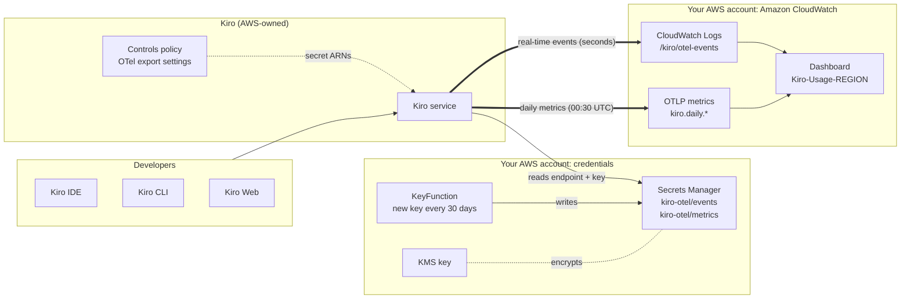
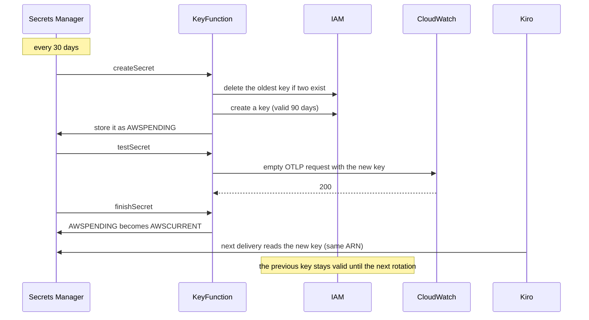

# Kiro observability on Amazon CloudWatch

[中文说明](README.zh-CN.md)

One CloudFormation stack that sends your Kiro Enterprise usage data to Amazon CloudWatch and gives you a ready-made dashboard:

- **Real-time events** (one record per LLM request and per tool call) go to a CloudWatch Logs log group.
- **Daily metrics** (`kiro.daily.*`, the same totals as the CSV report) go to CloudWatch OTLP metrics.
- The stack creates everything Kiro needs on the AWS side, **rotates the API keys automatically**, and
  **turns both exports on in your Kiro Controls policy**, changing only those settings.

It builds on the Kiro features [real-time events and private connectivity](https://kiro.dev/changelog/general/real-time-telemetry-and-private-connectivity/)
and [OpenTelemetry metrics](https://kiro.dev/docs/enterprise/monitor-and-track/user-activity/opentelemetry/).

## How the data flows



Kiro sends the data from its own service, not from developer machines, so nothing is installed on laptops.
The exports carry usage data (user ID and email, model, credits, durations, tool names and outcomes).
They do not carry prompts, responses, code or file content.


## What the stack creates

| Resource | Purpose |
|---|---|
| KMS key `alias/<NamePrefix>-export` | Encrypts the two secrets; its policy lets Kiro (`q.amazonaws.com`) decrypt them only through Secrets Manager |
| Log group `/kiro/otel-events` and stream `events` | Receives real-time events; bearer token authentication on; 30-day retention; kept when the stack is deleted |
| Two IAM users (names generated by CloudFormation) | One write-only identity per API key (the logs user can write only to this log group) |
| Secrets `<NamePrefix>/events`, `<NamePrefix>/metrics` | What Kiro reads: endpoint and API key. Resource policy allows only Kiro to read them |
| Lambda `KeyFunction` + two rotation schedules | Creates the API keys and rotates them every 30 days |
| Lambda `KiroPolicyFunction` | Merges the seven export settings into your Kiro Controls policy, validates and publishes it |
| Dashboard `Kiro-Usage-<Region>` and five saved Logs Insights queries | Viewing |

## Prerequisites

- Kiro Enterprise with **Controls** (Kiro Enterprise Management) in **US East (N. Virginia)** or **Europe (Frankfurt)**.
  Real-time events are available only in these two Regions.
- Deploy in the **same AWS account and Region as your Kiro profile**. With profiles in both Regions, deploy one stack in each.
- Permission to create IAM users and roles, KMS keys, secrets, Lambda functions and CloudWatch resources
  (`CAPABILITY_NAMED_IAM`), and to publish Kiro Controls policies.
- Clients: daily metrics and LLM request events come from every client. Tool call events need Kiro CLI 3.0.0+
  or the latest Kiro IDE; restart every open IDE window and `kiro-cli` process after you update.

## Deploy

**Console:** CloudFormation → Create stack → Upload a template file → `template/kiro-observability.yaml`.
Keep the defaults, acknowledge IAM resources, and create. Open the `DashboardUrl` output.

**CLI:**

```bash
git clone <this repository> && cd kiro-observability-cloudwatch
REGION=us-east-1 ./scripts/deploy.sh
```

`deploy.sh` creates or updates the stack (default name `kiro-observability`) and prints the outputs.
Pass any parameter as `Key=Value`; on update, parameters you don't pass keep their current values.

```bash
REGION=us-east-1 ./scripts/deploy.sh ConfigureKiroPolicy=false
REGION=us-east-1 ./scripts/deploy.sh CreateLogGroup=false LogGroupName=/my/existing/group
```

### Parameters

| Parameter | Default | Meaning |
|---|---|---|
| `NamePrefix` | `kiro-otel` | Prefix for the KMS alias and the secret names |
| `DashboardName` | empty = `Kiro-Usage-<Region>` | Dashboard name (dashboards are global, so it includes the Region); also the folder of the saved queries |
| `CreateLogGroup` | `true` | `false` = use an existing log group (it must already have bearer token authentication and the stream) |
| `LogGroupName` / `LogStreamName` | `/kiro/otel-events` / `events` | Where real-time events go |
| `RetentionInDays` | `30` | Log retention |
| `ConfigureKiroPolicy` | `true` | `false` = add the settings yourself from the `KglSettings` output |
| `KiroPolicyId` | empty | Controls policy ID. Empty = the one policy assigned to a Kiro profile |
| `KiroProfileId` | empty | Needed if several profiles have policies, or with `KiroIdentityStoreId` |
| `KiroIdentityStoreId` | empty | Only if your policy has rules with a `when` condition on users or groups |
| `KiroOnDelete` | `disable` | On stack delete, turn the two exports off (only if they still point at this stack's secrets) |
| `AllowExistingDraft` | `false` | `true` = publish even if the policy draft holds someone's unpublished changes |

### Outputs

| Output | Content |
|---|---|
| `DashboardUrl` | Link to the dashboard |
| `EventsSecretArn`, `MetricsSecretArn` | The secrets Kiro reads |
| `KiroPolicyId`, `KiroPolicyResult` | The policy the stack configured, and the published revision (or `unchanged`) |
| `KglSettings` | The settings the stack writes, for doing it by hand |
| `KeyRotation` | The rotation schedule |

## What the stack changes in your Kiro Controls policy

Only these keys under `settings:` of the policy's KGL file. Rules, other settings, comments and YAML tags stay as they are.

```yaml
settings:
  user_activity_report.enabled: true                 # "Collect metrics per user", needed by daily exports
  user_activity_report.otel_export: true
  user_activity_report.otel_secret_arn: "<MetricsSecretArn>"
  user_activity_report.otel_protocol: http/protobuf  # CloudWatch does not accept gRPC
  user_activity_report.otel_temporality: delta       # lower case; "Delta" fails validation
  realtime_event_export.enabled: true
  realtime_event_export.secret_arn: "<EventsSecretArn>"
```

- If the policy already has these values, nothing is published (`KiroPolicyResult` = `unchanged`).
- If the draft holds someone else's unpublished changes, the stack fails instead of publishing them.
- The change goes live for every user of the profile within about five minutes.
- To undo a publish: Kiro console → Controls → Actions → Revision history, or
  `aws kiro-em restore-enterprise-management-resource` (see the [API reference](https://kiro.dev/docs/enterprise/enterprise-management/api/)).

## Verify

1. Send one request from Kiro IDE or CLI.
2. Open the dashboard, or CloudWatch → **Logs → Log Analytics** → log group `/kiro/otel-events`, and run:
   ```
   filter eventName = "kiro.chat.message"
   | stats count(*) by attributes.kiro.model.name
   ```
   Records arrive within seconds.
3. Daily metrics arrive after the next 00:30 UTC (02:00 UTC before 2026-11-26). They do not appear under
   *All metrics*; use CloudWatch → **Query Studio** → **PromQL**, for example `{"kiro.daily.credits"}`.
   Metric names with dots must be quoted inside the braces.

Kiro does not notify you when a delivery fails, and it does not send activity from before the export was turned on.
For earlier usage, turn on the CSV report.

## The dashboard

| Section | Widgets |
|---|---|
| Totals | Credits, overage, requests, active users, sessions, tool calls requested (for the selected time range) |
| Users | Usage by user (tier, limit), credits per day by user |
| Models and clients | Credits by model, p50/p95 response time and cut-off answers by model, clients and versions |
| Trends | Credits per hour, requests per hour by client |
| Sessions | Most expensive sessions, agent mode and sub-agents, sessions by number of requests |
| Tools | Tool calls by tool, kind and outcome; MCP servers and errors |
| Detail | Latest 100 requests |
| Daily metrics | Latest-day numbers; daily credits by user and model; messages by client; average response time; client versions; top tools |

Daily-metric widgets use one-day windows because CloudWatch counts the PromQL range selector toward its 31-day query limit.

## API key rotation

Secrets Manager rotates each API key every **30 days**, and each key expires after **90 days**:



1. A new key is created and tested against the CloudWatch endpoint.
2. The secret's current value switches to the new key. The secret ARN never changes, so nothing changes in Kiro.
3. The previous key stays valid until the next rotation, so a request Kiro signed a moment earlier still succeeds.
4. At the next rotation, the oldest key is deleted (IAM allows two keys per user and service).

Kiro reads the secret on every delivery and does not cache it. Rotate on demand with
`aws secretsmanager rotate-secret --secret-id <EventsSecretArn>`.

## Update and delete

- Update: run `./scripts/deploy.sh` again, or update the stack with the new template.
- Delete: `aws cloudformation delete-stack --stack-name kiro-observability`. With `KiroOnDelete=disable`, the stack
  first turns the two exports off in your Kiro policy, then deletes the API keys, users, secrets, functions and dashboard.
  The log group and its data are kept. The KMS key is scheduled for deletion.

## Security notes

- The API keys are bearer tokens. They exist only in the secrets and are never printed, logged or returned as outputs.
- Who can read them: Kiro (through the secret resource policy) and principals in your account with
  `secretsmanager:GetSecretValue` and `kms:Decrypt` on these resources. Restrict those permissions.
- The logs key can write only to the one log group. The metrics key can write any metric in the account
  (`cloudwatch:PutMetricData` has no resource scope).
- The Kiro policy function's role is scoped by action with `Resource: "*"`: IAM does not accept resource ARNs for
  the Kiro Enterprise Management preview actions yet.
- The exports include user emails and IDs. Limit who can read the log group and query the metrics.

## Cost

You pay for Secrets Manager and KMS requests (Kiro reads the secret on each delivery, about twice every five seconds
for a busy profile), CloudWatch Logs ingestion and storage, OTLP metric series (one per user and breakdown value),
Logs Insights queries run by the dashboard, and two small Lambda functions.

## Troubleshooting

| Symptom | Cause | Fix |
|---|---|---|
| `KiroPolicy` fails: "unpublished draft changes" | Someone left a draft in Controls | Publish or discard it, or set `AllowExistingDraft=true` |
| `KiroPolicy` fails: "N policies assigned to a profile" | More than one profile | Set `KiroPolicyId` or `KiroProfileId` |
| `KiroPolicy` fails: validate error on a `when` rule | Policy uses user or group conditions | Set `KiroIdentityStoreId` and `KiroProfileId` |
| No events, but the stack succeeded | Policy not live yet, or no activity | Wait about five minutes, then send a Kiro request |
| LLM events but no `kiro.tool.call` | Old client | Kiro CLI 3.0.0+ or latest IDE, then restart it |
| Daily metric widgets empty | No export has run since the stack was deployed | Wait for 00:30 UTC |
| Can't find Logs Insights | It moved into Log Analytics (June 2026) | CloudWatch → Logs → Log Analytics |

## Development

The template is generated so the dashboard JSON and Lambda code stay readable:

```bash
python3 src/build_template.py template > template/kiro-observability.yaml
python3 -m unittest discover -s tests      # needs PyYAML
```

The tests check that the committed template is current, fits the 51,200-byte inline limit, that the dashboard and
Lambda code parse, that PromQL windows fit the 31-day limit, and that the policy merge leaves everything else alone.

## References

- Kiro: [Monitor per-user activity](https://kiro.dev/docs/enterprise/monitor-and-track/user-activity/),
  [Real-time events](https://kiro.dev/docs/enterprise/monitor-and-track/user-activity/real-time-events/),
  [OpenTelemetry metrics](https://kiro.dev/docs/enterprise/monitor-and-track/user-activity/opentelemetry/),
  [Prepare credentials](https://kiro.dev/docs/enterprise/monitor-and-track/user-activity/prepare-credentials/),
  [Turn on exports](https://kiro.dev/docs/enterprise/monitor-and-track/user-activity/turn-on/),
  [Enterprise Management](https://kiro.dev/docs/enterprise/enterprise-management/),
  [KGL reference](https://kiro.dev/docs/enterprise/enterprise-management/kgl/)
- AWS: [CloudWatch Logs bearer token authentication](https://docs.aws.amazon.com/AmazonCloudWatch/latest/logs/CWL_HTTP_Endpoints_BearerTokenAuth.html),
  [CloudWatch metrics bearer token authentication](https://docs.aws.amazon.com/AmazonCloudWatch/latest/monitoring/CloudWatch-OTLP-MetricsBearerTokenAuth.html),
  [PromQL querying](https://docs.aws.amazon.com/AmazonCloudWatch/latest/monitoring/CloudWatch-PromQL-Querying.html),
  [Log Analytics](https://docs.aws.amazon.com/AmazonCloudWatch/latest/logs/LogAnalytics.html),
  [Secrets Manager rotation](https://docs.aws.amazon.com/secretsmanager/latest/userguide/rotating-secrets.html)
